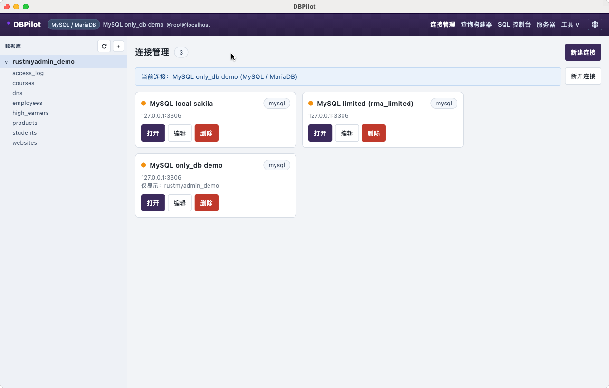
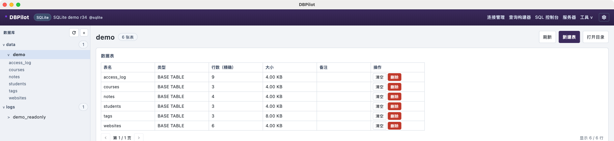
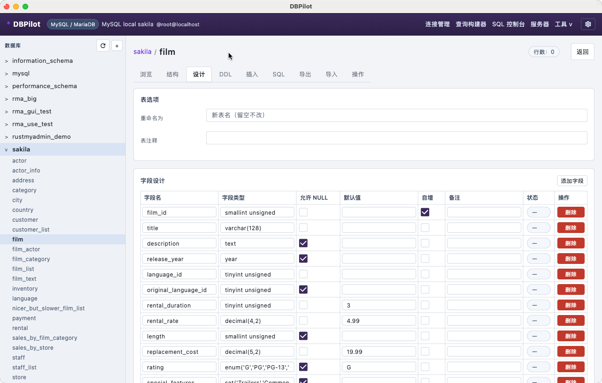
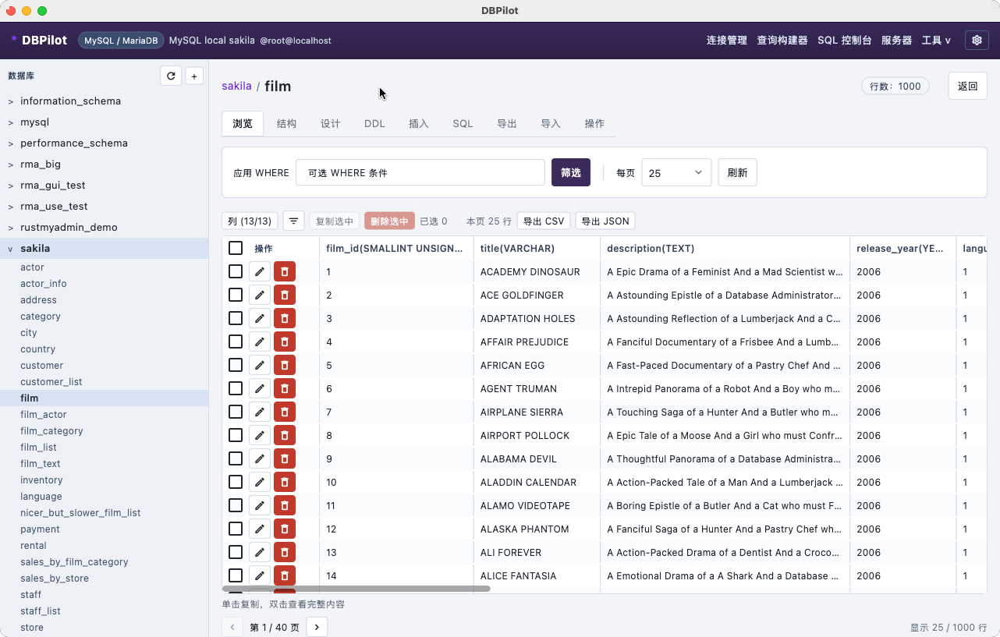
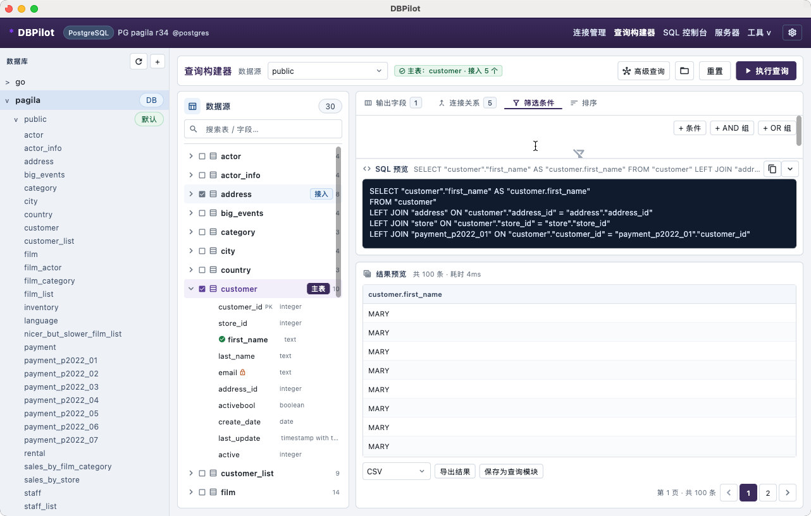
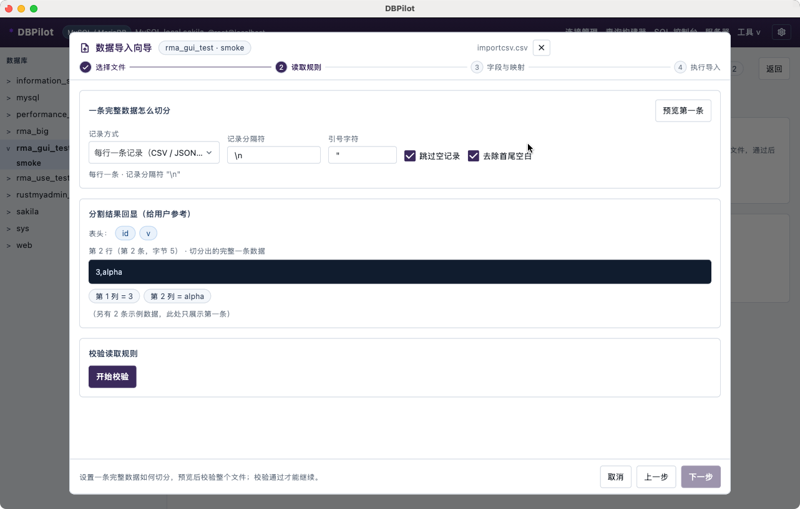

# DBPilot

[](https://github.com/L-Y-P/DBPilot/actions/workflows/build.yml)
[](https://github.com/L-Y-P/DBPilot/releases)
[](LICENSE)
[](#编译)

**DBPilot 是一个本地优先、开箱即用的跨平台数据库管理桌面客户端。**
界面用 Flutter，数据库与网络全部交给 Rust，通过进程内 FFI 直接调用——没有服务端、没有账号体系，
连接信息、查询历史与备份都只留在你自己的机器上。

支持 **MySQL / MariaDB、PostgreSQL、SQLite**，覆盖日常数据库工作的完整链路：
**连接管理（SSH 跳板 / TLS·mTLS）→ 库表对象浏览 → 可视化表设计 → 数据浏览与批量编辑 →
SQL 控制台 / 查询构建器 → Excel·CSV·SQL 导入 → E-R 关系图 → 备份还原与结构同步**；
界面支持中英双语、深浅色与 6 套主题色。

- **本地优先**：无云端、无遥测上传；数据目录 0700、文件 0600，连接密码不会离开本机。
- **三平台一致**：macOS（universal x86_64 + arm64）、Windows x64、Linux（AppImage / deb / rpm）。
- **流式处理**：大文件导入导出、SQL 文件执行、备份还原都不整表载入内存；`keyset` 游标分页替代 OFFSET。
- **中文友好**：中文类型说明、术语解释，以及面向普通用户的可操作错误提示（如 MySQL 1452 孤儿行预检）。



| | |
| --- | --- |
| 界面 | Flutter 3.47.7 / Dart 3.13（Material 3，中英双语，深浅色 + 6 套主题色） |
| 内核 | Rust 2021（sqlx 0.8 / tokio 1 / russh 0.45 / rustls） |
| 桥接 | flutter_rust_bridge 2.13（类型安全 FFI，无 HTTP、无本地端口） |
| 平台 | macOS（universal x86_64 + arm64）、Windows x64、Linux（GTK3） |
| 许可 | MIT，见 [LICENSE](LICENSE) |

---

## 技术栈

| 层 | 组件 | 说明 |
| --- | --- | --- |
| UI | **Flutter 3.47.7 / Dart 3.13** | Material 3；`window_manager` 管窗口、`file_picker` 管文件对话框、`path_provider` 管数据目录 |
| FFI | **flutter_rust_bridge 2.13** | 类型安全的进程内调用，不起 HTTP 服务、不开本地端口 |
| 契约层 | **dbpilot-core**（独立 crate） | `DatabaseDialect` / `DatabaseDriver` / `DriverRegistry` / `ConnectionHandle`，不依赖任何驱动实现 |
| 驱动 | **sqlx 0.8**（mysql / postgres / sqlite） | 三个内置驱动作为静态插件注册，方言 SQL 落在 `drivers/<id>/dialect.rs` |
| 运行时 | **tokio 1**（多线程） | 长任务（导入 / SQL 文件）`tokio::spawn` + 进度/取消 |
| 网络 | **russh 0.45** + **rustls** | SSH 本地端口转发（跳板机）、TLS / mTLS 证书校验 |
| 序列化 | serde / serde_json / chrono / uuid | 跨 FFI 数据统一是 JSON |

分层：

```text
Flutter UI（Dart）              lib/src/**：shell / views / components / builder
      │  flutter_rust_bridge 2.13（JSON 进出）
Rust api 层（唯一 FFI 表面）    rust/src/api/*
      │
Rust 编排层                     state.rs（授权边界）· pools.rs（连接池 LRU 5 + 隧道）
      │
契约层 dbpilot-core             trait / 方言 / 注册表 / DTO / SQL 工具
      │
驱动层                          drivers/{mysql,postgres,sqlite}
      │
引擎与持久化                    importer · exporters · ssh · secure（0600 原子写）
```

## 支持的数据库

| 数据库 | 实测版本 | 说明 |
| --- | --- | --- |
| MySQL | **8.4.11** | 也支持 MariaDB（同驱动、同方言） |
| PostgreSQL | **17.11** | 多 schema、实例级连接、`pg_stat_activity` / 角色管理 |
| SQLite | 文件 3.54 / 内置运行时 3.46 | 一个连接 = 一个目录（主文件 + 自动 ATTACH 同目录其它文件） |

标识符引号、布尔/二进制字面量、`EXPLAIN`、`USE` / `SET search_path`、系统库与权限过滤
都在各自驱动的 `dialect.rs` 里，UI 不感知方言差异。

## 功能

**连接管理** —— 多连接并列（颜色 / 分组 / 驱动徽标）；SSH 跳板（密码 / 私钥 / agent，主机密钥 TOFU 或严格校验）；
TLS / mTLS（`disable` / `require` / `verify-ca` / `verify-full` + 自定义 CA 与客户端证书）；
连接字符集、默认库、`only_db` / `hide_db` 可见性边界；测试连接、分阶段打开反馈（5 秒后可取消）。

**对象浏览** —— 库 / 模式 → 表、视图、存储过程 / 函数、触发器、事件，每页 50 条；
行数估算、大小、备注；权限不足的对象隐藏并提示数量；查看 DDL、清空、删除、新建。



**表设计器** —— 可视化 ALTER TABLE：表选项、字段、索引、外键，全部带 SQL 预览后再应用；独立 DDL 页签；
改动未应用前可点「撤销未应用的修改」一键回到数据库当前结构（确认后仅丢弃待应用的改动，不改数据库）；
每列可单独「还原该列」、表名/注释可单独重置；字段改名会真正执行 RENAME COLUMN（驱动拆成独立语句保证 MySQL/PG 顺序正确）；
改名撞名 / 两列互换名 / 新名为空时，应用前会明确列出哪几条改名不会生效（可取消或继续应用其余修改），不再静默跳过。



**数据网格** —— 列显示 / 隐藏、逐列筛选、多列排序、批量删除、单元格复制与展开、行内编辑；
批量编辑会暂存并在工具栏显示「未保存 N 处」（上限 2000 个单元格）；**跨页保持**：有主键表翻页 / 排序 / 筛选 / 改每页条数后编辑仍在，
「保存全部改动」把多页编辑合并成一次单事务写入（失败停留并保留全部编辑）；无主键表按整行匹配不可靠，翻页仍会确认；
保存后若有 UPDATE/DELETE 未命中任何行（例如行已被删除或键被修改）会区分提示「未命中（目标行不存在）」与「值未变化」；刷新 / 切页签 / 切表仍会确认
（取消 / 放弃修改并继续 / 保存后继续），切表时提示「保存到原表或放弃」。
keyset 游标分页；自动列宽开关与大字段延迟加载（设置 → 性能）。



**SQL 控制台** —— 语法高亮（>120 KiB 退化为纯文本）、执行 / EXPLAIN / 取消（`KILL QUERY` / `pg_cancel_backend`）、
结果每页 50 行、查询历史；导入 SQL 文件（小文件进编辑器，大文件流式执行）。

**查询构建器** —— 数据源树、输出字段 / 连接关系 / 筛选条件 / 排序四个工作区；聚合、去重、别名；
参数化 SQL 预览；多方言适配（FULL OUTER JOIN 原生或 UNION 改写、ILIKE、字面量转义）；跨库查询；
结果分页预览与导出，可保存为查询模块。
生成的 SQL 对当前数据源显式加命名空间限定（PG 模式.表 / MySQL 库.表 / SQLite main.表），
因此不依赖会话 search_path：即使之前跑过 pg_dump 那种把 search_path 置空的脚本，构建器查询也不会再报 42P01；
一对多连接放大结果行数时，结果头会注明是哪些子表造成的。



**数据导入向导** —— 五步：选文件 → 读取规则（Excel 为「工作表与表头」）→ 字段映射 → 执行 → 建立关联。
支持分隔文本 / JSON 数组 / JSON Lines / XML / HTML / **Excel 工作簿（.xlsx / .xls / .xlsb / .ods / SpreadsheetML）** / Markdown / SQL 脚本；
自动识别格式（内容优先、扩展名兜底）；多工作表文件在读取规则里选择要导入的工作表，可设置表头行与跳过开头 N 行；
整文件校验报「第 N 行（第 X 条，字节 Y）：原因」；试插入（事务内 INSERT + 回读 + ROLLBACK）；
**全链路流式读取与校验**：xlsx/xlsm、SpreadsheetML、ODS、xls(BIFF8)、xlsb 全部逐行流式解析（行数据不整表载入内存，只有共享字符串表按字符串总量加载）；
分批写入（默认 500 行/批、可取消）；NULL 与空串在所有格式里可区分；隐藏工作表自动排除
（xlsx / xls / xlsb / ODS / SpreadsheetML 一致，并提示「已忽略 N 个隐藏工作表」）；
加密的 Office 文件、被改成 Excel 扩展名的 HTML/XML、路径不存在或无权限都会给中文说明。



**从文件快速建表** —— 新建表对话框标题栏 / 数据库页「从文件建表」：选文件 → 工作表与字段 → 创建并导入 → 建立关联。
多工作表可选「全部导入（每张工作表建一张表）」或自定义勾选；按前 1000 行自动推断字段类型
（整数 / 大整数 / 小数 / 布尔 / 日期 / 日期时间 / 时间 / 文本）并推荐主键，表名、列名、类型、可空均可改；
文本列默认留长度余量（短文本 `VARCHAR(255)`，不再按样本顶满）；学号/订单号这类业务编号会被推荐为
主键但**默认不自增**（只有「添加自增 id 主键」或显式勾选才自增）；同一张表的 `*_id` 外键列会自动
对齐成主键整数类型（`BIGINT`），避免 MySQL 外键类型不兼容（ERROR 3780）。一次 CREATE TABLE +
批量导入，失败保留已建表并可重试（失败后重试不会重复弹外键预检）；回退到字段步骤时会先按外键依赖反序删表；
关闭向导时若还有未导入成功的已建表，会先让用户选择「保留 / 删除本次已建表 / 取消」；
标题栏的「术语说明」用日常语言解释主键、外键、唯一、中间表、事务等行话；
「添加自增 id 主键」生成的列可在字段表格「操作」列删除，需要时再一键加回（不会留下删不掉的列）。

**E-R 关系图** —— 导入/快速建表后的最后一步，也可从数据库页「关系图」随时打开：
默认最多同时展示 20 张表（第 68 轮从 10 提高，大 schema 可一次看到更多；到达上限时按钮置灰并说明可先移除部分表）；已存在的外键自动画成**带箭头的连线**（目标端实心三角、hover 高亮）；
加入一张表会**自动带入与它关联的父/子表**（可撤销）；画布内容超出时可**按住空白处拖动平移视角**（节点/连线拖动优先）；
从字段连接点拖到另一张表的字段即可创建外键，
点击箭头查看/删除或设置约束（级联 / 置空 / 限制 / 不操作，中文界面不出现 SQL 关键字）；
**多对多推导**：恰好两个单列外键的表识别为「中间表」，在两端实体表之间画出「多对多 · 中间表」关系线（可折叠）；
新建外键可选「多对多（自动创建中间表）」；画布内的表按 `xxx_id` 列名推导「建议关系」虚线边
（只跳过已有外键的列，应用一条后其余建议仍在；点击虚线可单条建立，工具栏可一键批量建立，帮助入口
解释推导规则；建立失败会逐条显示数据库错误，不再静默）。
新建单列外键前会**预检子表数据**：若已有行在引用表中找不到对应记录，先弹窗说明数量、两端示例值，
并在引用表存在同名列时提示可能是引用列选错（例如「学生名单.学号」数据匹配但没有唯一索引，需先建 UNIQUE 再引用；同名列只有部分数据匹配时也会给出匹配行数/剩余孤儿数）；
确认后仍可继续尝试，数据库拒绝时展示可行动的中文说明而不是 1452 原文。
若被引用列不是唯一键（MySQL 8.4 要求 UNIQUE/PK）且该列数据全部唯一，可一键「创建唯一索引并重试」，
自动建 UNIQUE 后重开弹窗；有重复值时只说明重复数量与示例，不自动建索引。
若孤儿警告发现引用表有同名且至少部分匹配的列（例如「学生名单.学号」），可直接「创建唯一索引并改用该列」一键改选修复；
基本完全匹配与部分匹配都可一键改选（后者会诚实说明改用后仍可能残留孤儿、创建仍可能失败）；
索引名冲突（1826）会自动换序号名重试，最多 5 个候选名（uk_x … uk_x_5）。
批量建立前会确认（N 条、立即写入数据库、不能一键全部撤销）并显示建立进度；删除外键前二次确认；
「自动带入关联表」只沿**数据库里已有外键**扩展，库里还没有外键或到达画布上限时会明确提示（并给出还有几张关联表未加入）；
折叠中间表后「多对多 · 中间表」标签会避让到连线上方，橙色连线保持可见；工具栏同样有「术语说明」。
工具栏的「关系列表」侧栏把当前画布上的**真实外键 / 建议关系 / 多对多**汇总成可搜索的清单
（可按表名、列名或外键约束名搜索；长关系名省略后可悬停看完整关系与约束名）：
点击定位到关系（真实外键可打开详情删除、建议可单条建立、多对多可折叠/展开中间表），密集画布也不用到处找线。
示例文件：`desktop/rust/tests/fixtures/relational_multi.xlsx`（5 表 users/categories/products/orders/order_items）与 `chinese_grade.xlsx`（中文：学生名单 / 年级成绩单）。

**导出** —— SQL / CSV / JSON / XML / HTML / TXT / Excel / Markdown 八种格式；
表页、整库、查询结果共用同一套 writer，全部流式写出。

**备份与恢复** —— 按库或按表备份成 .sql（带头部元信息），备份目录可切换，每页 20 条；恢复前确认并报告语句数。
PostgreSQL / SQLite 还原是**整段原子**的（一个事务，任一语句失败整体回滚并提示未写入任何数据）；
MySQL 的 DDL 会隐式提交，仍按语句分组提交，界面上会说明无法整段回滚。

**结构比对与同步** —— 同连接内任选源 / 目标库或模式，逐表比对字段、主键、索引、注释；只生成 DDL，可预览，
可选删除目标多余字段 / 索引（外键、触发器、函数不创建，界面明示）。

**服务器与账号** —— 状态 / 变量 / 进程 / 账号四个页签；MySQL 进程终止与权限矩阵，PostgreSQL
`pg_stat_activity` 与角色属性，SQLite 文件级信息（按驱动与权限显示）。

**界面** —— 中英双语（含 Rust 后端错误）；深浅色 + 6 套主题色；窗口尺寸记忆，最小 960×600。


## 性能

本机实测，同机前后对照（含约 14 ms 测试框架开销）：

| 场景 | 优化前 | 优化后 | 做法 |
| --- | --- | --- | --- |
| DataGrid 40 列 × 500 行首帧 | 2.40 s | **1.30 s** | 列宽缓存 + 列虚拟化 + 采样 200 → 50 行 |
| DataGrid 父级重建 | 734 ms | **157 ms** | 同上；单帧单元格 1200 → 390 |
| GridTable 600 行首帧 | 1297 ms | **137 ms** | 行虚拟化（>150 行走固定表头 + ListView.builder） |
| 构建器结果预览单帧单元格 | 943 | **207** | 按（结果身份, 页码）复用 widget + 列虚拟化 |
| 构建器结果预览翻页 | 301 ms | **118.9 ms** | 同上 |
| 查询构建器 tab 切换 | 37 ms | **13.7 ms** | ValueNotifier 局部重建 + IndexedStack 常驻 |
| 100 MB CSV 导入 MySQL（252 万行） | 21.48 s / 4.66 MB/s | **14.58 s / 6.86 MB/s** | ROUND65 零拷贝快速路径 + ROUND66 独立 Tokio 消费者/单写入连接有界流水线；DB 时间≈14.5 s（详见 analysis/IMPORT_PERF_ROUND65.md、IMPORT_PIPELINE_ROUND66.md） |

其它与数据处理相关的设计：

- **keyset 游标分页**替代 OFFSET（单列主键升序时走索引范围扫描），配合延迟关联；游标页不发 `COUNT(*)`。
- **大字段延迟加载**：超过 200 字符只渲染前 120 字符 + 徽标，双击看全文。
- **自动列宽可关闭**：关掉后所有列固定 160 px，完全不跑 `TextPainter` 测量。
- **导入流式**：文本格式 64 KiB 分块；Excel 全格式按行流式解析与校验（xlsx/xlsm 用 zip+XML、xls 用 OLE2+BIFF record、xlsb 用 ZIP entry+BRT record），批量 INSERT 默认 500 行、可取消；单记录 8 MiB / 单语句 16 MiB 上限。
  分隔文本（CSV/TSV）走零拷贝快速路径：复用记录缓冲、按字节区间切字段、直接写 INSERT 缓冲，不再逐格创建 String/Vec<Value>；带引号的记录仍走完整引号/转义状态机。批量行数可配置（默认 500，500–2000 实测接近，5000 更慢）；`transaction_batches` 为实验选项（默认 1，实测合并事务反而更慢）。`pipeline_batches` 默认 2：CSV 生产者在独立 Tokio task 中与单写入连接消费者重叠，100 MB / 252 万行实测 14.58 s / 6.86 MB/s（相对串行 18.69 s / 5.35 MB/s，耗时 −22%、吞吐 +28%），队列容量 2/4 差异 <1%；详见 analysis/IMPORT_PIPELINE_ROUND66.md。显式设 1 可回退串行。
  共享字符串表（xlsx sharedStrings / xls SST / xlsb sharedStrings）为该格式决定的字符串索引表，一次性加载。
  单文件超过 **5 GiB（5×1024³ 字节）** 时给出提示（统一 GiB 口径，并提醒共享字符串表/SST 的内存峰值风险；
  能流式读取的格式只提醒耗时；将来若出现必须整表载入的读取路径会直接拒绝）。护栏判定只读文件头，
  不会为了判断而预解析整个工作簿。
- **导出流式**：逐行写出，不把整表拼成一个大字符串。

## 使用

**获取**：从 [Releases](https://github.com/L-Y-P/DBPilot/releases) 下载压缩包，或按下一节自行编译。

| 平台 | 文件 | 说明 |
| --- | --- | --- |
| macOS | `DBPilot-<version>-macos.dmg` | universal（x86_64 + arm64）；ad-hoc 签名未公证，首次打开需右键 → 打开，或 `xattr -dr com.apple.quarantine /Applications/DBPilot.app` |
| Windows x64 | `DBPilot-<version>-windows-x64-setup.exe` | NSIS 安装包（推荐）：开始菜单/桌面快捷方式 + 卸载项；未签名时 SmartScreen 选「仍要运行」 |
| Windows x64 | `DBPilot-<version>-windows-x64-portable.zip` | 免安装版，解压即用 |
| Linux x64 | `DBPilot-<version>-linux-x64.AppImage` | 免安装：`chmod +x` 后直接运行，需要 `libfuse2` |
| Linux x64 | `dbpilot_<version>_amd64.deb` | Debian / Ubuntu：`sudo apt install ./dbpilot_<version>_amd64.deb` |
| Linux x64 | `dbpilot-<version>-1.x86_64.rpm` | Fedora / RHEL / openSUSE：`sudo rpm -i dbpilot-<version>-1.x86_64.rpm` |

**第一次使用**：

1. 打开应用 → **新建连接**，选驱动填主机 / 端口 / 账号 / 密码 / 数据库；需要时在 **SSL** 页签配 TLS、
   在 **SSH** 页签配跳板机。
2. **测试连接** 通过后保存，回到连接管理点 **打开**。
3. 左侧树选库 / 模式 → 表；右侧表页有浏览 / 结构 / 设计 / DDL / 插入 / SQL / 导出 / 导入 / 操作九个页签。
4. 顶栏进 **查询构建器**、**SQL 控制台**、**服务器**、**工具**（备份 / 结构同步 / 历史），右上角齿轮打开设置。

**数据存放**（文件 0600、目录 0700）：

| 平台 | 目录 |
| --- | --- |
| macOS | `~/Library/Application Support/com.rustmyadmin.rustMyadminDesktop/` |
| Windows | `%APPDATA%\com.rustmyadmin\DBPilot\` |
| Linux | `~/.local/share/com.rustmyadmin.rust_myadmin_desktop/` |

包含 `connections.json`（含密码，明文 0600）、`settings.json`、`query_history.json`、`backups/`。
没有接系统钥匙串，介意的话请用只有该库权限的专用账号。

**检查更新 / 自动更新**：设置 → 关于 → 检查更新，读取仓库根 `update.json`（地址编译在
`lib/src/update_source.dart`，界面不提供输入框）。发现新版本后会按清单里的 `assets`
自动下载对应平台的安装包、安装并重启（macOS 原地替换 .app；Windows 静默安装并触发 UAC；
Linux 仅 AppImage 支持原地更新），进度与失败原因都在设置面板里，失败可重试或用下载地址手动更新。
发版流程见 [docs/RELEASE.md](docs/RELEASE.md)。

逐页操作见 [docs/USAGE.md](docs/USAGE.md)。

## 编译

**前置**

| 依赖 | 版本 |
| --- | --- |
| Flutter | **3.47.7**（stable，Dart 3.13.5） |
| Rust | stable（2021 edition，开发机实测 1.99.1） |
| macOS | Xcode 完整版 + CocoaPods；universal 包需 `aarch64-apple-darwin` 与 `x86_64-apple-darwin` |
| Windows | VS 2022「使用 C++ 的桌面开发」（MSVC 14.4x + Win SDK 10）+ `x86_64-pc-windows-msvc` |
| Linux | GTK3 开发库、CMake、Ninja、`pkg-config` |
| codegen | `cargo install flutter_rust_bridge_codegen --version 2.13.0`（只在改 Rust API 后需要） |

三个桌面平台不能交叉编译，各自在本平台构建。

**构建**

```bash
flutter pub get

flutter build macos   --release   # build/macos/Build/Products/Release/DBPilot.app
flutter build windows --release   # build/windows/x64/runner/Release/
flutter build linux   --release   # build/linux/x64/release/bundle/

# Linux 三种安装包（AppImage / deb / rpm，本地与 CI 共用同一份脚本）
# 依赖：apt install -y file libfuse2 rpm zstd desktop-file-utils，另需 appimagetool
VERSION=1.0.0 bash packaging/linux/build-packages.sh
```

Rust 部分由 cargokit 在 `flutter build` 内部自动触发，产物落在 `build/` 下，不复用 `rust/target`。

**改了 Rust API 之后**

`api/` 里新增或改签名的 `pub fn` 必须重新生成 Dart 绑定：

```bash
flutter_rust_bridge_codegen generate   # 配置见 flutter_rust_bridge.yaml
```

只改返回字段的组装不需要 codegen。

**测试**

```bash
dart analyze                                          # 应为 0 issue
cd rust && cargo test --offline -- --test-threads=1    # hermetic，不需要数据库
cd .. && flutter test                                  # 需先 cargo build --lib 生成 debug 动态库

make rust-live-up   # Docker 起 MySQL 8.4 + PostgreSQL 17
make rust-live      # hermetic + live 全套
make rust-live-down # 停库并删卷
```

live 套件的端点全部来自环境变量 `DBPILOT_TEST_MYSQL_*` / `DBPILOT_TEST_PG_*`，
仓库里不含任何账号密码；详见 [docs/CI_LIVE_TESTS.md](docs/CI_LIVE_TESTS.md)。

当前基线：`dart analyze` 0 issue、`flutter test` 380 passed + 11 skip、`cargo test` 183 passed / 17 ignored。

**常见构建坑**

- 不要用 `flutter build macos --release --no-pub`：SPM/CocoaPods 混合状态下会链接失败并清掉插件 framework。
- macOS 需要真实 `HOME` 与 `PUB_CACHE=~/.pub-cache`，受限沙箱里会卡在 SwiftPM 缓存权限。
- Windows 上 Flutter 的 CMake 会调 `rustup run stable cargo build`，`rustup` 必须在 PATH 上。
- 首次无缓存时 Rust 依赖全量编译约 7–9 分钟。

更多文档：[ARCHITECTURE.md](docs/ARCHITECTURE.md)（分层与驱动插件）、
[RELEASE.md](docs/RELEASE.md)（发版与更新清单）、[CONTRIBUTING.md](CONTRIBUTING.md)（提交规范与测试门禁）。

## 许可证

[MIT](LICENSE) © 2026 L-Y-P
